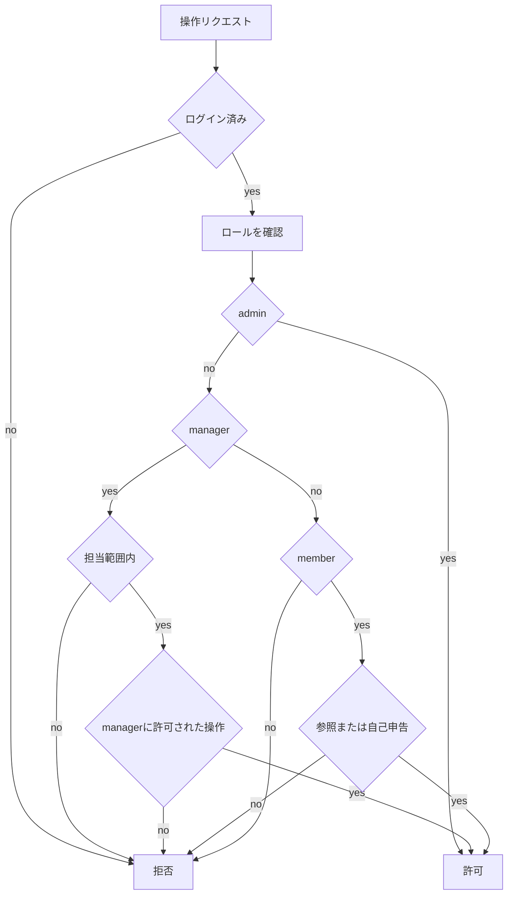
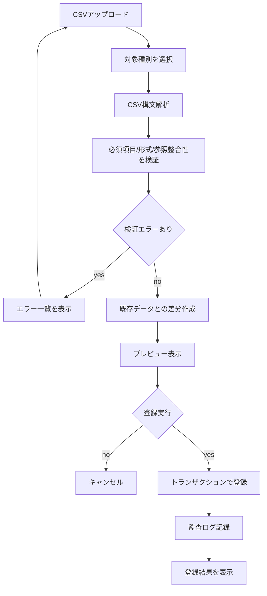
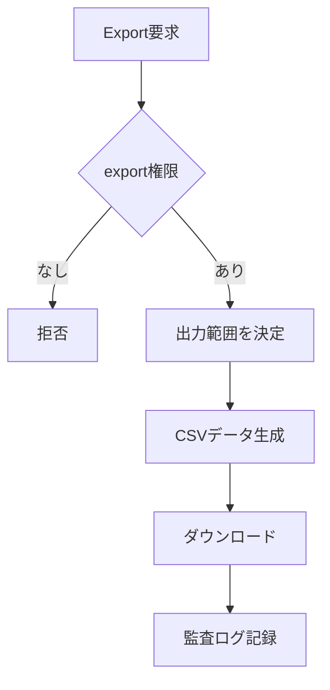

# CSV・権限・監査設計

## 目的

このドキュメントは、権限ロール、CSV import/export仕様、監査ログ方針を定義します。

CSV対象は主要マスタに限定します。

AI の作成は `AiJob` の予約と実行結果に記録します。

## 権限ロール

`admin` は基盤の `X-Auth-User-Role`、`manager` は基盤の組織でリーダーになっている利用者、その他は `member` で決まります。MANAGER の担当範囲はリーダーであるノードと配下の利用者です。画面とAPIの両方で同じ権限判定を適用します。

| 操作 | `admin` | `manager` | `member` |
| --- | --- | --- | --- |
| ダッシュボード閲覧 | 可 | 可 | 可（本人向け表示） |
| チーム目標を決める・変える | 可（部下がいる本人分） | 可（部下がいる本人分） | 不可 |
| チーム目標を見る | 本人とその部下 | 本人とその部下 | 自分の上司の目標のみ |
| メンバー閲覧 | 可 | 可 | 不可（本人情報は自分のスキル画面で確認） |
| メンバー作成 | 可 | 不可 | 不可 |
| メンバー更新 | 可 | 不可 | 不可 |
| メンバー削除/無効化 | 可 | 不可 | 不可 |
| スキル閲覧 | 可 | 可 | 自分のスキルのみ可 |
| スキル作成/更新/無効化 | 可 | 不可 | 不可 |
| 自分のスキル申告 | 可 | 可 | 可 |
| 申告スキルの承認・補正 | 可 | 担当範囲のみ可 | 不可 |
| 承認済みメンバースキルの訂正（設定・削除） | 可 | 担当範囲のみ可 | 不可 |
| ロール閲覧 | 可 | 可 | 不可 |
| ロール作成/更新/無効化 | 可 | 不可 | 不可 |
| 通知閲覧 | 可 | 自分宛のみ可 | 自分宛のみ可 |
| CSV export | 可 | 不可 | 不可 |
| CSV import | 可 | 不可 | 不可 |
| 監査ログ閲覧 | 可 | 不可 | 不可 |
| 育成のヒントの閲覧・作成 | 可 | 担当範囲のみ可 | 不可 |
| AI の利用状況の閲覧 | 可 | 不可 | 不可 |
| 権限変更 | 不可（基盤のロール・組織で決定） | 不可 | 不可 |

### 画面アクセス

| 画面 | `admin` | `manager` | `member` |
| --- | --- | --- | --- |
| ダッシュボード | 可 | 可 | 可 |
| メンバー、スキルマップ | 可 | 可 | 不可 |
| スキル管理 | 可 | 不可 | 不可 |
| ロール | 全社の状況を含めて可 | 担当範囲の状況を含めて可 | 自分の達成状況を閲覧可 |
| 自分のスキル、通知 | 可 | 可 | 可 |
| スキル承認 | 可 | 可 | 不可 |
| CSV、監査ログ | 可 | 不可 | 不可 |
| AI の利用状況 | 可 | 不可 | 不可 |

ナビゲーション表示とURL直接アクセスの両方に同じ画面アクセス判定を適用します。許可されていない画面へ直接アクセスした場合は、利用可能なダッシュボードへ遷移します。

`manager`の通常の担当範囲は、自分の部署、配下のすべての部署、直属の部下です。メンバー一覧、スキルマップ、メンバー詳細、承認、育成のヒントで同じ範囲を使います。組織ダッシュボードだけは、これに加えて同じ親部署を持つ並列部署そのものの匿名集計を閲覧できますが、並列部署の配下と個人名は表示しません。URLで指定された部署IDもサーバー側で範囲を検証します。`admin`は全社を閲覧でき、部署で絞ると配下も含めます。

権限判断は以下の流れで行います。

## CSV対象

初期リリースのCSV import/export対象は主要マスタに限定します。

| 対象 | Import | Export | 用途 |
| --- | --- | --- | --- |
| スキル | 可 | 可 | スキルマスタの初期登録、更新 |
| メンバースキル | 可 | 可 | 承認済みメンバー別スキル、レベルの一括登録、更新 |
| ロール（要件を含む） | 可 | 可 | ロールと要件の一括登録、更新 |
| 監査ログ | 不可 | 不可 | 内部 ID が多く読み取りにくいため、画面で確認する（2026-10-17 決定） |
| 育成のヒント（AI） | 対象外 | 対象外 | AI予約（`AiJob`）で管理 |

## CSV項目

出力と取り込みは同じ形式にする。出力したCSVを編集して、そのまま取り込める。共通の決まりは以下です（2026-10-16 決定）。

- 文字コード：出力は UTF-8（BOM 付き）、改行は CRLF。取り込みは UTF-8 と Shift_JIS を自動で判別して受け付ける（Excel の既定の保存形式に対応するため）。
- 値の表記：真偽値は `true`／`false`、日付は `YYYY-MM-DD`、空の値は空欄。
- 表計算ソフトで数式として実行されないよう、出力では先頭が `=`、`+`、`-`、`@` の値の前に `'` を付ける。取り込みでは、この `'` を取り除く。
- メンバースキルの出力は、範囲を「在籍中」（初期）と「すべて（無効な利用者を含む）」から選べる。
- 追加の列：スキルCSVは `skill_code`、`skill_name`、`category_name`、`description`、`is_active`、`level_guide_1`、`level_guide_2`、`level_guide_3`、`level_guide_4`、`level_guide_5`。ロールCSVは `role_code`、`role_name`、`description`、`is_active`、`skill_code`、`required_level`、`is_required`、`any_of_group`。
- ロールCSVは1行に1つの要件を出力する。
- 要件がないロールは要件の列を空欄にして1行出力する。
- ロール要件のOR組は `any_of_group` に1以上の同じ整数を指定し、2件以上の要件を「いずれか1つ」の組として扱う。

指定したスキルカテゴリが存在しない場合は、カテゴリ一覧の末尾に新規作成する。新規スキルとカテゴリを移動したスキルは、移動先カテゴリ内の末尾に配置する。

### スキルCSV

| 項目 | 必須 | 説明 |
| --- | --- | --- |
| `skill_code` | 任意 | スキルコード。一意。空欄は新規として扱い、コードを自動で振る。登録済みのコードは更新に使い、登録のないコードはエラーにする |
| `skill_name` | 必須 | スキル名 |
| `category_name` | 必須 | スキルカテゴリ名 |
| `description` | 任意 | 説明 |
| `is_active` | 必須 | `true` または `false` |
| `level_guide_1` | 任意 | Lv1 の目安。300文字以内 |
| `level_guide_2` | 任意 | Lv2 の目安。300文字以内 |
| `level_guide_3` | 任意 | Lv3 の目安。300文字以内 |
| `level_guide_4` | 任意 | Lv4 の目安。300文字以内 |
| `level_guide_5` | 任意 | Lv5 の目安。300文字以内 |

レベルの目安の列は、5つすべてをそろえるか、5つとも省略する。5つとも省略した場合は既存の目安を変更しない。列がある場合はCSVの内容に置き換え、空欄のレベルは目安なしとして個別の目安を削除し、共通の目安を使う。

### メンバースキルCSV

| 項目 | 必須 | 説明 |
| --- | --- | --- |
| `email` | 必須 | 基盤利用者のメールアドレス。取り込み時にテナントの利用者一覧と一括照合する |
| `skill_code` | 必須 | スキルコード |
| `level` | 必須 | 1から5 |
| `years_of_experience` | 任意 | 経験年数 |
| `last_assessed_at` | 任意 | 最終評価日。`YYYY-MM-DD` |

取り込みでレベルが変わった行は、レベルの変更履歴（`SkillLevelChange`）に変更元「CSV import」として記録する。レベルアップの演出と通知は出さない。
基盤にメールがない行はエラーとし、対応する `Member` がまだない場合は `platformUserId` から自動作成する。出力時のメールも基盤の利用者情報から解決する。

### ロールCSV

| 項目 | 必須 | 説明 |
| --- | --- | --- |
| `role_code` | 任意 | 登録済みのコードは更新に使う。空欄は新規として自動採番し、登録のないコードはエラーにする |
| `role_name` | 必須 | ロール名。`role_code` を指定した更新では名前も変更できる |
| `description` | 任意 | 説明 |
| `is_active` | 必須 | `true` または `false` |
| `skill_code` | 要件がある場合は必須 | 要件のスキルコード |
| `required_level` | 要件がある場合は必須 | 1から5 |
| `is_required` | 要件がある場合は必須 | `true` または `false` |
| `any_of_group` | 任意 | OR組を表す1以上の整数。同じ番号を2件以上に指定する |

CSVに載っているロールの要件はCSVの内容に置き換え、CSVにない要件は削除する。CSVに載っていないロールは変更しない。`role_code` が空欄の行は `role_name` ごとに1つの新規ロールとしてまとめ、登録済みの名前と同じ場合はエラーにする。同じ `role_code` の行では、ロール名、説明、状態をそろえる。ロール自体の削除は行わず、無効化は `is_active=false` を指定する。

## CSV import処理

CSV importは即時登録せず、アップロード、検証、プレビュー、差分確認、登録の順で進めます。実行できるのは `admin` だけで、登録前の差分プレビューで確認するため、別の承認フローは設けません。

検証方針は以下です。

- 必須項目が空の場合はエラーにする。
- 一意制約に違反する場合はエラーにする。
- 参照先の部署、メンバー、スキルが存在しない場合はエラーにする。
- スキルレベルが1から5以外の場合はエラーにする。
- 同一CSV内でキーが重複する場合はエラーにする。
- エラーが1件でもある場合は、全件を登録しない。エラーを直したCSVを選び直してもらう（一部だけ取り込まれる混乱を避けるため。2026-10-16 決定）。
- 既存データとの差分は、新規、更新、変更なしに分類する。

## CSV export処理

CSV exportは `admin` だけが実行できます。`manager` と `member` はexportできません。

## 監査ログ方針

監査ログは、誰が、いつ、何を、どの対象に対して行ったかを追跡できる粒度で記録します。

| 記録対象 | 操作 | 記録内容 |
| --- | --- | --- |
| メンバー | 作成、更新、無効化、上司・目標ロールの設定 | actor、target、変更前後の差分、発生日時 |
| 部署 | 作成、更新、無効化 | actor、target、変更前後の差分、発生日時 |
| スキル | 作成、更新、無効化、削除、レベルの目安の更新、並び替え | actor、target、変更前後の差分、並び替え件数、発生日時 |
| スキルカテゴリ | 作成、更新、削除 | actor、target、変更前後の差分、発生日時 |
| 大分類 | 作成、名前の変更、削除、並べ替え、カテゴリの割り当て | actor、target、変更前後の差分、割り当ては大分類の名前、発生日時 |
| 前提スキルの関係 | 登録（AIの候補・手での追加）、削除 | actor、target、スキルと前提スキルの名前、登録元、発生日時 |
| スキル申告 | 作成、再申告 | actor、target、申告内容、発生日時 |
| 申告スキル承認 | 承認、補正承認、差し戻し | actor、target、申告内容、補正内容、コメント、発生日時 |
| メンバースキル | 作成、更新、削除 | actor、target、変更前後の差分、承認元、発生日時 |
| ロール | 作成、更新、無効化、削除、要件の追加・削除 | actor、target、変更前後の差分、発生日時 |
| CSV import | commit による登録、preview・commit の検証失敗、読み取り失敗、previewToken の不一致 | actor、対象種別、段階、件数、先頭5件のエラー概要、発生日時。セル値と元ファイルの内容は残さない |
| CSV export | 出力 | actor、対象種別、件数、出力範囲、発生日時 |
| 権限 | 付与、変更、剥奪 | actor、target user、変更前後のロール、発生日時 |
| パスワードの発行 | 初回ログイン用のパスワードの発行 | actor、target user、発生日時。パスワードの値は記録しない |
| 育成のヒント（AI） | 監査ログには残さない | AI予約に依頼者、対象、状態、種類、所要時間、失敗理由を残す |
| プロフィール | 監査ログには残さない | ひとことと相談タグは本人だけが編集する |
| 月の振り返り | 監査ログには残さない | 演出を閉じた月（`lastRecapSeenMonth`）の更新は記録しない |
| チーム目標 | 作成、変更 | actor、目標、変更前後、発生日時 |

監査ログの保持方針は以下です。

- 初期方針として最低1年間保持する。
- 個人情報を含む差分は必要最小限にする。
- 監査ログ自体の更新、削除は通常画面から行わない。
- CSV importの元ファイルは保存しない。件数とエラーの概要を監査ログに残す（2026-10-15 決定）。
- 通知の作成と既読は、件数が多く調査に役立たないため記録しない（2026-10-15 決定）。
- スキル申請の承認依頼は、基盤の `GetDirectLeaderIDs` が返す直属リーダーに送る。直属リーダーがいない場合は、基盤の組織にいる `ADMIN` に送る。そのメンバーの承認待ち申請がなくなった時点で、承認依頼を既読にする。
- 共通のレベルの目安は`SKILL_LEVEL_GUIDES_UPDATE`、並び替えは`SKILL_REORDER`として記録する。カテゴリをまたぐ移動では、移動したスキルの更新も記録する。
- 大分類は`skill_category_group.*`、前提スキルの関係は`skill_prerequisite.*`として記録する。前提スキルの候補づくり（AI）は、育成のヒントと同じくAI予約に残し、1日50件の上限を共通にする。
- レベルアップへのリアクションは、レベルアップごとに1件の`LEVEL_UP_REACTED`通知にまとめ、新しいリアクションで書き換えて未読に戻す。本人の返信は、そのレベルアップにコメントした人へ`LEVEL_UP_COMMENTED`で通知する（R6でPhase 4.7の「リアクションは通知しない」を変更）。
- CSVは大分類、前提スキル、申請のひとことを扱わない（R6時点）。

## 実装の対応表

### 画面

| 画面 | 許可するロール | 担当範囲・本人判定 |
| --- | --- | --- |
| ダッシュボード | admin、manager、member | member は本人表示。manager は担当範囲。 |
| メンバー | admin、manager | manager は担当範囲の一覧だけを取得。 |
| スキル管理 | admin | なし。 |
| スキルマップ | admin、manager | manager は担当範囲。 |
| ロール | admin、manager、member | member は本人、manager は担当範囲、admin は全社の達成状況を表示。 |
| 自分のスキル、通知、探す、プロフィール | admin、manager、member | セッションの memberId または公開範囲を使用。 |
| スキル承認 | admin、manager | manager は担当範囲。 |
| CSV、監査ログ | admin | なし。 |
| AI の利用状況 | admin | なし。 |

### API

| API | 許可するロール | 担当範囲・本人判定 |
| --- | --- | --- |
| `GET /api/talent/v1/members` | admin、manager | manager は担当範囲。 |
| `POST /api/talent/v1/members`、`DELETE /api/talent/v1/members/[memberId]` | admin | なし。 |
| `PATCH /api/talent/v1/members/[memberId]` | admin | なし。 |
| `/api/talent/v1/members/[memberId]/skills` | admin、manager | manager は担当範囲。 |
| `/api/talent/v1/members/[memberId]/avatar` | admin、manager、member | サービスで本人だけを許可。 |
| `/api/skill-assessments` | admin、manager、member | 作成対象はセッション本人。参照は manager の担当範囲。 |
| `/api/skill-assessments/[assessmentId]/review` | admin、manager | manager は担当範囲。 |
| スキル、カテゴリ、ロールの参照 API | admin、manager | なし。 |
| スキル、カテゴリ、ロールの更新 API | admin | なし。 |
| 通知 API | admin、manager、member | セッション本人宛だけ。 |
| CSV import/export | admin | なし。 |
| パスワード API | admin、manager、member | セッション本人だけ。 |

### Server Action

| Server Action | 許可するロール | 担当範囲・本人判定 |
| --- | --- | --- |
| メンバー作成、無効化、上司設定、権限変更 | admin | TalentHub 内で変更できる権限は member と manager。ADMIN は基盤で決まる。 |
| メンバー更新 | admin | なし。 |
| メンバースキルの訂正（設定・削除） | admin、manager | manager は担当範囲。 |
| 目標ロール更新 | admin、manager、member | member は本人だけ。 |
| スキル申告 | admin、manager、member | セッション本人だけ。 |
| 申告審査、一括承認 | admin、manager | manager は担当範囲。 |
| スキル、カテゴリ、ロールの更新 | admin | なし。 |
| 通知既読、公開設定、アバター、パスワード | admin、manager、member | セッション本人だけ。 |
| 1on1 メモ | admin、manager | 対象の上司であることをサービスで判定。 |
| メンバーの振り返りの取得 | admin、manager | manager は担当範囲。応援とコメントは件数だけ返す。 |
| 月の振り返りを閉じた記録 | admin、manager、member | セッション本人だけ。 |
| 応援、リアクション、コメント | admin、manager、member | 公開範囲と対象範囲をサービスで判定。レベルアップへのリアクションとコメントは、admin、本人の上司、同じ部署の在籍中の人。 |
| 大分類、前提スキルの関係の更新 | admin | なし。 |
| 育成のヒントの取得、作成 | admin、manager | manager は担当範囲。 |
| 提案用スキルシートの取得、生成、保存 | admin、manager | manager は担当範囲。本人であっても member は不可。 |

## 経歴・資格

| 対象 | MEMBER本人 | 担当範囲のMANAGER | ADMIN | その他 |
| --- | --- | --- | --- | --- |
| 経歴・資格・シート基本情報の閲覧と更新 | 可 | 可 | 可 | 不可 |

監査操作は `member_career.create`、`member_career.update`、`member_career.delete`、`member_certification.create`、`member_certification.delete`、`member.skill_sheet_basics.update` を記録する。経歴・資格の CSV 取り込み・出力はない。

提案用スキルシートは `proposal_sheet.generate` と `proposal_sheet.update` を対象種別 `ProposalSheetDraft` で記録し、監査画面ではメンバーのグループに分類する。
## Excel ひな形と提案用スキルシート出力

| 操作 | ADMIN | MANAGER | MEMBER | 監査の操作名 |
| --- | --- | --- | --- | --- |
| ひな形の登録・名前変更・差し替え・削除・ダウンロード | 可 | 不可 | 不可 | `skill_sheet_template.create` / `skill_sheet_template.update` / `skill_sheet_template.delete` |
| 提案用スキルシートの Excel 出力 | 可 | 担当範囲のみ可 | 不可 | `proposal_sheet.export` |

ひな形の監査対象は `SkillSheetTemplate`、出力の監査対象は `ProposalSheetDraft` とします。ファイルの内容は監査ログへ保存しません。

## H-4c の監査表示

メンバーに関する監査ログの before / after には氏名・メール・社員番号を保存しません。操作した人と対象者は Member ID を保存し、表示時に基盤の利用者情報から氏名を解決します。氏名検索も基盤の表示プロフィールから Member ID を求めて絞り込みます。

## H-4d の整理

部署・メンバー CSV と、それらの作成・更新・無効化・役割・上司変更の監査操作は廃止しました。過去ログに未知の操作・対象種別が残る場合は、保存されている種類名をそのまま表示します。
