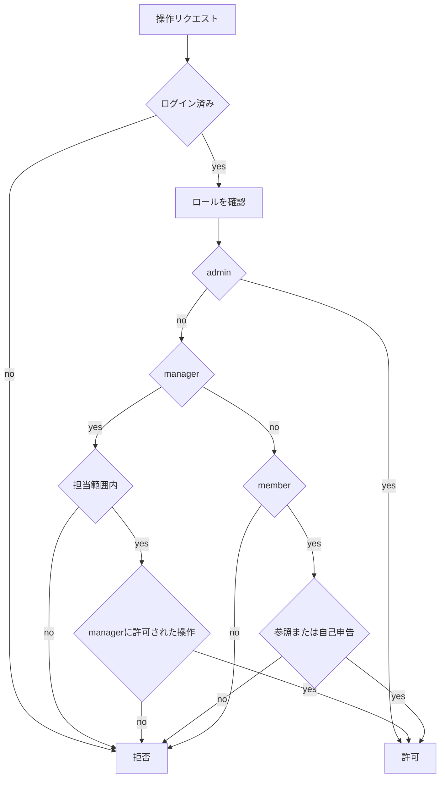
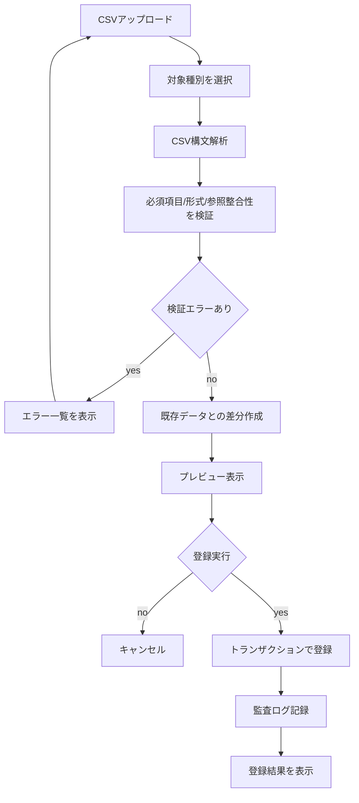
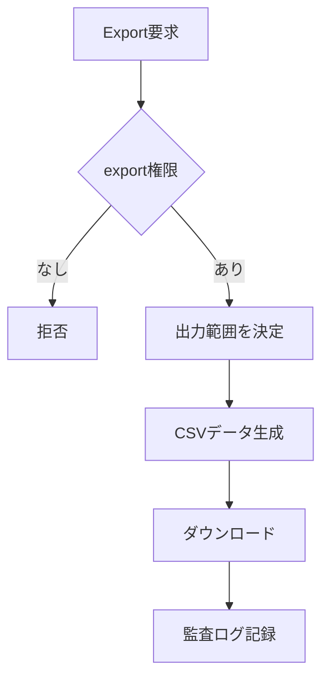

# CSV・権限・監査設計

## 目的

このドキュメントは、権限ロール、CSV import/export仕様、監査ログ方針を定義します。

初期リリースでは、CSV対象を主要マスタに限定し、AI評価は監査対象の将来候補としてのみ扱います。

## 権限ロール

初期ロールは `admin`、`manager`、`member` の3種類です。画面とAPIの両方で同じ権限判定を適用します。

| 操作 | `admin` | `manager` | `member` |
| --- | --- | --- | --- |
| ダッシュボード閲覧 | 可 | 可 | 可（本人向け表示） |
| メンバー閲覧 | 可 | 可 | 不可（本人情報は自分のスキル画面で確認） |
| メンバー作成 | 可 | 不可 | 不可 |
| メンバー更新 | 可 | 担当範囲のみ可 | 不可 |
| メンバー削除/無効化 | 可 | 不可 | 不可 |
| スキル閲覧 | 可 | 可 | 自分のスキルのみ可 |
| スキル作成/更新/無効化 | 可 | 不可 | 不可 |
| 自分のスキル申告 | 可 | 可 | 可 |
| 申告スキルの承認・補正 | 可 | 担当範囲のみ可 | 不可 |
| 承認済みメンバースキルの直接更新 | 可 | 不可 | 不可 |
| ロール閲覧 | 可 | 可 | 不可 |
| ロール作成/更新/無効化 | 可 | 不可 | 不可 |
| 通知閲覧 | 可 | 自分宛のみ可 | 自分宛のみ可 |
| CSV export | 可 | 不可 | 不可 |
| CSV import | 可 | 不可 | 不可 |
| 監査ログ閲覧 | 可 | 不可 | 不可 |
| 権限変更 | 可 | 不可 | 不可 |

### 画面アクセス

| 画面 | `admin` | `manager` | `member` |
| --- | --- | --- | --- |
| ダッシュボード | 可 | 可 | 可 |
| メンバー、スキル、スキルマップ、ロール | 可 | 可 | 不可 |
| 自分のスキル、通知 | 可 | 可 | 可 |
| スキル承認 | 可 | 可 | 不可 |
| CSV、監査ログ | 可 | 不可 | 不可 |

ナビゲーション表示とURL直接アクセスの両方に同じ画面アクセス判定を適用します。許可されていない画面へ直接アクセスした場合は、利用可能なダッシュボードへ遷移します。

権限判断は以下の流れで行います。

## CSV対象

初期リリースのCSV import/export対象は主要マスタに限定します。

| 対象 | Import | Export | 用途 |
| --- | --- | --- | --- |
| 部署 | 可 | 可 | 部署マスタの初期登録、更新 |
| メンバー | 可 | 可 | メンバー基本情報の一括登録、更新 |
| スキル | 可 | 可 | スキルマスタの初期登録、更新 |
| メンバースキル | 可 | 可 | 承認済みメンバー別スキル、レベルの一括登録、更新 |
| ロール（要件を含む） | 後続 | 可 | 初期は画面編集を主とする |
| 監査ログ | 不可 | 不可 | 内部 ID が多く読み取りにくいため、画面で確認する（2026-10-17 決定） |
| AI評価 | 対象外 | 対象外 | Phase 6で再設計 |

## CSV項目

出力と取り込みは同じ形式にする。出力したCSVを編集して、そのまま取り込める（ロールとロール要件は出力のみ）。共通の決まりは以下です（2026-10-16 決定）。

- 文字コード：出力は UTF-8（BOM 付き）、改行は CRLF。取り込みは UTF-8 と Shift_JIS を自動で判別して受け付ける（Excel の既定の保存形式に対応するため）。
- 値の表記：真偽値は `true`／`false`、日付は `YYYY-MM-DD`、空の値は空欄。メンバーの状態は `active`／`inactive`／`leave`。
- 表計算ソフトで数式として実行されないよう、出力では先頭が `=`、`+`、`-`、`@` の値の前に `'` を付ける。取り込みでは、この `'` を取り除く。
- メンバーとメンバースキルの出力は、範囲を「在籍中」（初期）と「すべて（休職・退職を含む）」から選べる。
- 追加の列：ロールCSVは `role_name`、`description`、`is_active`、`skill_code`、`required_level`、`is_required`。
- ロールCSVは1行に1つの要件を出力する。
- 要件がないロールは要件の列を空欄にして1行出力する。

### 部署CSV

| 項目 | 必須 | 説明 |
| --- | --- | --- |
| `department_code` | 必須 | 部署コード。一意 |
| `department_name` | 必須 | 部署名 |
| `parent_department_code` | 任意 | 親部署コード |
| `is_active` | 必須 | `true` または `false` |

### メンバーCSV

| 項目 | 必須 | 説明 |
| --- | --- | --- |
| `employee_no` | 必須 | 社員番号。一意 |
| `name` | 必須 | 氏名 |
| `email` | 必須 | メールアドレス。一意 |
| `department_code` | 必須 | 所属部署コード |
| `job_title` | 任意 | 役職、職種 |
| `status` | 必須 | `active`、`inactive`、`leave` |
| `manager_employee_no` | 任意 | 上司の社員番号。自分自身と循環は拒否する |
| `target_role_name` | 任意 | 目標ロールの名前 |

### スキルCSV

| 項目 | 必須 | 説明 |
| --- | --- | --- |
| `skill_code` | 任意 | スキルコード。一意。空の行は新規として扱い、コードを自動で振る。コードがある行は、そのスキルの更新として扱う |
| `skill_name` | 必須 | スキル名 |
| `category_name` | 必須 | スキルカテゴリ名 |
| `description` | 任意 | 説明 |
| `is_active` | 必須 | `true` または `false` |

### メンバースキルCSV

| 項目 | 必須 | 説明 |
| --- | --- | --- |
| `employee_no` | 必須 | 社員番号 |
| `skill_code` | 必須 | スキルコード |
| `level` | 必須 | 1から5 |
| `years_of_experience` | 任意 | 経験年数 |
| `last_assessed_at` | 任意 | 最終評価日。`YYYY-MM-DD` |

取り込みでレベルが変わった行は、レベルの変更履歴（`SkillLevelChange`）に変更元「CSV import」として記録する。レベルアップの演出と通知は出さない。

## CSV import処理

CSV importは即時登録せず、アップロード、検証、プレビュー、差分確認、登録の順で進めます。実行できるのは `admin` だけで、登録前の差分プレビューで確認するため、別の承認フローは設けません。

検証方針は以下です。

- 必須項目が空の場合はエラーにする。
- 一意制約に違反する場合はエラーにする。
- 参照先の部署、メンバー、スキルが存在しない場合はエラーにする。
- スキルレベルが1から5以外の場合はエラーにする。
- 同一CSV内でキーが重複する場合はエラーにする。
- エラーが1件でもある場合は、全件を登録しない。エラーを直したCSVを選び直してもらう（一部だけ取り込まれる混乱を避けるため。2026-10-16 決定）。
- 既存データとの差分は、新規、更新、変更なしに分類する。

## CSV export処理

CSV exportは `admin` だけが実行できます。`manager` と `member` はexportできません。

## 監査ログ方針

監査ログは、誰が、いつ、何を、どの対象に対して行ったかを追跡できる粒度で記録します。

| 記録対象 | 操作 | 記録内容 |
| --- | --- | --- |
| メンバー | 作成、更新、無効化、上司・目標ロールの設定 | actor、target、変更前後の差分、発生日時 |
| 部署 | 作成、更新、無効化 | actor、target、変更前後の差分、発生日時 |
| スキル | 作成、更新、無効化、削除、レベルの目安の更新 | actor、target、変更前後の差分、発生日時 |
| スキルカテゴリ | 作成、更新、削除 | actor、target、変更前後の差分、発生日時 |
| スキル申告 | 作成、再申告 | actor、target、申告内容、発生日時 |
| 申告スキル承認 | 承認、補正承認、差し戻し | actor、target、申告内容、補正内容、コメント、発生日時 |
| メンバースキル | 作成、更新、削除 | actor、target、変更前後の差分、承認元、発生日時 |
| ロール | 作成、更新、無効化、削除、要件の追加・削除 | actor、target、変更前後の差分、発生日時 |
| CSV import | 検証、登録、失敗 | actor、対象種別、件数、エラー概要、発生日時 |
| CSV export | 出力 | actor、対象種別、件数、出力範囲、発生日時 |
| 権限 | 付与、変更、剥奪 | actor、target user、変更前後のロール、発生日時 |
| AI評価 | 後続 | Phase 6で実行、再評価、失敗、利用ログを設計する |

監査ログの保持方針は以下です。

- 初期方針として最低1年間保持する。
- 個人情報を含む差分は必要最小限にする。
- 監査ログ自体の更新、削除は通常画面から行わない。
- CSV importの元ファイルは保存しない。件数とエラーの概要を監査ログに残す（2026-10-15 決定）。
- 通知の作成と既読は、件数が多く調査に役立たないため記録しない（2026-10-15 決定）。

## 実装の対応表

### 画面

| 画面 | 許可するロール | 担当範囲・本人判定 |
| --- | --- | --- |
| ダッシュボード | admin、manager、member | member は本人表示。manager は担当範囲。 |
| メンバー | admin、manager | manager は担当範囲の一覧だけを取得。 |
| スキル、スキルマップ、ロール | admin、manager | manager は参照のみ。スキルマップは担当範囲。 |
| 自分のスキル、通知、探す、プロフィール | admin、manager、member | セッションの memberId または公開範囲を使用。 |
| スキル承認 | admin、manager | manager は担当範囲。 |
| CSV、監査ログ | admin | なし。 |

### API

| API | 許可するロール | 担当範囲・本人判定 |
| --- | --- | --- |
| `GET /api/members` | admin、manager | manager は担当範囲。 |
| `POST /api/members`、`DELETE /api/members/[memberId]` | admin | なし。 |
| `PATCH /api/members/[memberId]` | admin、manager | manager は担当範囲。 |
| `/api/members/[memberId]/skills` | admin、manager | manager は担当範囲。 |
| `/api/members/[memberId]/avatar` | admin、manager、member | サービスで本人だけを許可。 |
| `/api/skill-assessments` | admin、manager、member | 作成対象はセッション本人。参照は manager の担当範囲。 |
| `/api/skill-assessments/[assessmentId]/review` | admin、manager | manager は担当範囲。 |
| スキル、カテゴリ、ロールの参照 API | admin、manager | なし。 |
| スキル、カテゴリ、ロールの更新 API | admin | なし。 |
| 通知 API | admin、manager、member | セッション本人宛だけ。 |
| CSV import/export | admin | なし。 |
| パスワード API | admin、manager、member | セッション本人だけ。 |

### Server Action

| Server Action | 許可するロール | 担当範囲・本人判定 |
| --- | --- | --- |
| メンバー作成、無効化、上司設定、権限変更 | admin | 権限変更は自分自身、最後の在籍中 admin、部下がいる対象を追加判定。 |
| メンバー更新、メンバースキル設定・削除 | admin、manager | manager は担当範囲。 |
| 目標ロール更新 | admin、manager、member | member は本人だけ。 |
| スキル申告 | admin、manager、member | セッション本人だけ。 |
| 申告審査、一括承認 | admin、manager | manager は担当範囲。 |
| スキル、カテゴリ、ロールの更新 | admin | なし。 |
| 通知既読、公開設定、アバター、パスワード | admin、manager、member | セッション本人だけ。 |
| 1on1 メモ | admin、manager | 対象の上司であることをサービスで判定。 |
| 応援、リアクション、コメント | admin、manager、member | 公開範囲と対象範囲をサービスで判定。 |
