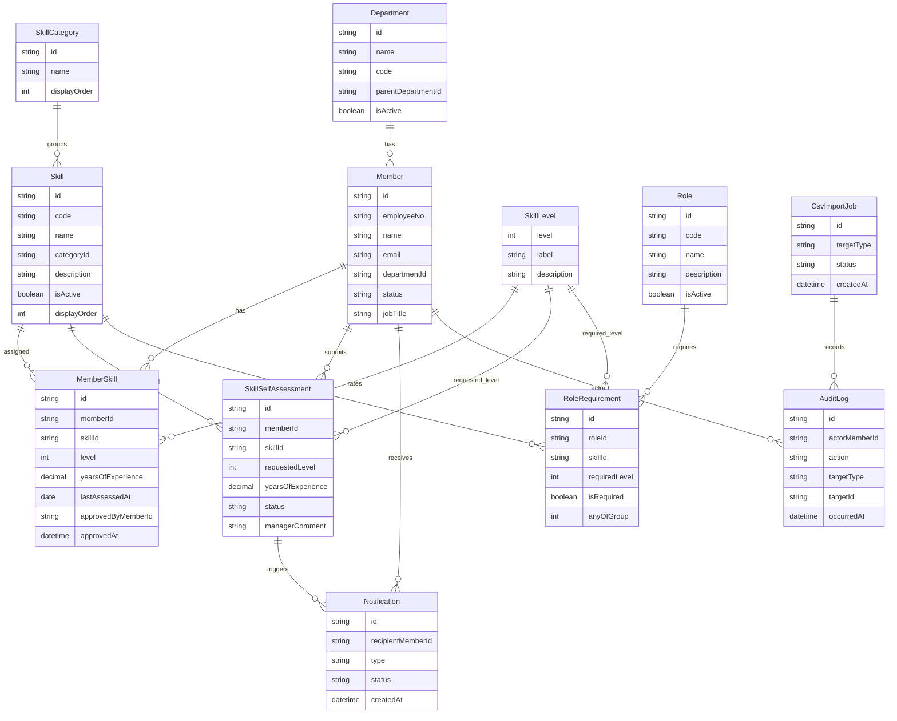
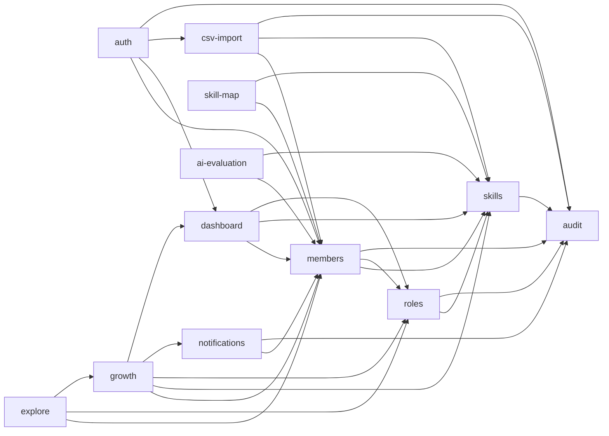

# ドメイン設計

## 目的

このドキュメントは、業務範囲、ドメインモデル、モジュール境界、主要ユースケースを定義します。DBスキーマの正は `prisma/schema.prisma` です。

## 対象範囲

メンバーのスキル情報を正しく登録し、検索、可視化、ロール達成状況の確認、成長の後押しまでを扱います。

| 区分 | 含めるもの |
| --- | --- |
| メンバー管理 | メンバー基本情報、部署、在籍状態、プロフィール、検索 |
| スキル管理 | スキル、カテゴリ、スキルレベル定義 |
| スキル紐付け | メンバー自身によるスキル申告、managerによる承認・補正、確定済み保有スキル |
| ロール管理 | ロール、必要スキル、必要レベル、達成判定 |
| 可視化 | スキル検索、スキルマップ、統計ダッシュボード |
| CSV | 部署、メンバー、スキル、メンバースキルのimport/export |
| 権限 | `admin`、`manager`、`member` のRBAC |
| 通知 | スキル申告、承認依頼、承認結果の通知 |
| 監査 | 作成、更新、削除、承認・差し戻し、CSV import/export、権限変更の記録 |

以下は含めません。

- 承認フロー付きCSV import。
- 外部人事システム連携。

育成のヒントは `ai-evaluation` モジュールが扱います。

AIには承認済みのスキルとレベル、目標ロールの要件だけを送ります。
AI 呼び出し前に機能ごとのトークン量を利用ログへ予約し、月の上限を原子的に判定します。実行者ごとの直近10分の呼び出しも数え、10件以上は一時的に制限します。

氏名、メール、社員番号は送りません。

生成結果と入力のハッシュを保存して再利用し、作り直しにも対応します。

利用ログには実行した人、対象、状態、トークン数、所要時間、理由を保存します。

## ドメインモデル

主要なエンティティと関連は以下です。

## 主要エンティティ

| エンティティ | 役割 | 主な制約 |
| --- | --- | --- |
| `Department` | 部署、部門、チームなどの所属単位 | `code` は一意。無効化しても過去メンバーとの関連は保持する |
| `Member` | スキル管理対象者 | `employeeNo` と `email` は一意。在籍状態を持つ。メールはログイン ID と同じ値で、変更時は両方を更新する。部下がいるメンバーは無効・休職にできない |
| `SkillCategory` | スキルの分類 | 表示順を持つ |
| `Skill` | 管理対象スキル | コードは自動採番し、作成後は変更しない。CSVの照合に使う。名前、カテゴリ、大分類は後から変更できる。同一カテゴリ内で名称重複を避け、カテゴリ内の表示順を持つ |
| `SkillLevel` | 1から5のレベル定義 | 初期値は固定マスタとして扱う |
| `MemberSkill` | 承認済みのメンバーとスキルの紐付け | `memberId` と `skillId` の組み合わせは一意。manager承認後の値を保持する |
| `SkillSelfAssessment` | メンバー自身が申告したスキル更新依頼 | `pending`、`approved`、`corrected`、`rejected` の状態を持つ |
| `Notification` | ユーザーへの業務通知 | 承認依頼、承認結果、差し戻しを通知する |
| `Role` | 職務、期待役割、キャリアロール | コードは自動採番し、作成後は変更しない。CSVの照合に使う。名前は後から変更できる。無効化しても過去判定の参照は可能にする。達成した人がいるロールは削除せず、無効にする |
| `RoleRequirement` | ロール達成に必要なスキル条件 | `roleId` と `skillId` の組み合わせは一意。`anyOfGroup` が同じ必須要件は「いずれか1つ」を満たせば1つの達成単位として扱い、`null` は単独要件とする |
| `RoleAchievement` | メンバーがロールを達成した事実 | 達成した日時と達成時点の要件を記録し、レベルや要件が変わっても削除・更新しない。要件0件のロールは達成にならない |
| `AuditLog` | 重要操作の履歴 | 業務データから直接更新しない |
| `CsvImportJob` | CSV importの実行単位 | プレビュー、検証、登録結果の追跡に使う |

ロールの達成表示は `RoleAchievement` の有無で決めます。記録があり現在の要件も満たす場合は「達成」、記録があり現在の要件を満たさない場合は「達成（要件が更新されました）」、記録がない場合は「未達成」です。進み具合と不足スキルは現在の要件で計算します。達成のお祝いはロールごとに1回だけ表示し、「目標ロール達成」バッジと獲得日は目標として達成した記録から決めます。

## スキルレベル

スキルレベルは1から5で表現します。

| レベル | ラベル | 意味 |
| --- | --- | --- |
| 1 | Beginner | 基本概念を理解し、支援を受けて作業できる |
| 2 | Basic | 定型作業を自力で進められる |
| 3 | Intermediate | 通常業務で実用でき、周囲へ説明できる |
| 4 | Advanced | 複雑な課題を解決し、設計や改善を主導できる |
| 5 | Expert | 組織横断で標準化、育成、技術判断をリードできる |

## モジュール境界

業務境界は以下です。モジュール間連携は公開されたuse caseまたはservice経由に限定し、他モジュールのinfrastructure層へ直接依存しません。

| モジュール | 責務 |
| --- | --- |
| `members` | メンバー、部署、在籍状態、メンバースキルのユースケース |
| `skills` | スキル、カテゴリ、レベル定義、スキル検索のユースケース |
| `roles` | ロール、ロール要件、達成判定のユースケース |
| `skill-map` | メンバーとスキルのマトリクス表示用データ取得 |
| `dashboard` | 統計、未設定、ロール達成状況などの集計 |
| `csv-import` | CSVの検証、プレビュー、差分、登録、export |
| `auth` | 認証済みユーザー、RBAC、操作可否判定 |
| `audit` | 重要操作の記録、検索、保持方針 |
| `notifications` | スキル申告、承認依頼、承認結果の通知 |
| `ai-evaluation` | 育成のヒントの生成、保存、再利用、AI利用ログの記録と集計 |
| `growth` | レベルアップの演出とフィード、バッジ、目標ロール、応援、1on1メモ、月の振り返り |
| `explore` | 探す画面とスキルプロフィール |

## 主要ユースケース

| ユースケース | 主体 | 概要 |
| --- | --- | --- |
| メンバーを登録する | `admin` | 社員番号、氏名、メール、部署、在籍状態を登録する |
| メンバー情報を更新する | `admin`、`manager` | 基本情報や所属を更新する。`manager` は担当範囲に限定する |
| スキルを登録する | `admin` | カテゴリ、名称、説明を登録する |
| 自分のスキルを申告する | `member` | 自身のスキル、レベル、経験年数を申告し、managerへ承認依頼を送る |
| 申告スキルを承認・補正する | `manager` | 担当範囲の申告内容を確認し、承認、補正承認、差し戻しを行う |
| メンバーにスキルを直接紐付ける | `admin` | 初期整備や例外対応として、承認済みスキルを直接登録する |
| ロールを定義する | `admin` | ロール名と必要スキル条件を登録する |
| ロール達成状況を確認する | `admin`、`manager`、`member` | メンバーの保有スキルとロール要件を比較する |
| スキルでメンバーを検索する | `admin`、`manager`、`member` | スキル、レベル、部署などで対象者を検索する。`member` は公開範囲に限定する |
| スキルマップを確認する | `admin`、`manager`、`member` | 部署やスキルカテゴリ単位で分布を確認する。`member` は公開範囲に限定する |
| 通知を確認する | `admin`、`manager`、`member` | 承認依頼、承認結果、差し戻し通知を確認する |
| CSVをimportする | `admin` | 主要マスタの一括登録、更新をプレビュー後に実行する |
| CSVをexportする | `admin`、`manager` | 権限範囲内の主要マスタを出力する |
| 監査ログを確認する | `admin` | 重要操作の履歴を検索、確認する |

## 成長体験

成長タイムライン、レベルアップ演出、チームダッシュボード、応援、1on1の土台として、次のエンティティと関連を持ちます。

| エンティティ・関連 | 目的 | 主な属性・制約 | 可視範囲・通知 |
| --- | --- | --- | --- |
| `Member.manager` / `Member.reports` | 上司と直属メンバーを表し、承認担当範囲を決める | 自己参照と循環は禁止。上司候補は在籍中かつ`ADMIN`または`MANAGER`のユーザーに紐づくメンバー | `ADMIN`が設定する。`MANAGER`の承認範囲は直属メンバーと上司未設定メンバー |
| `Member.targetRole` | 本人が目指すキャリアロールを表す | 設定時点で有効な`Role`だけを指定できる。未設定を許容する | `ADMIN`が設定し、本人のセットアップ進捗と成長画面で利用する |
| `SkillLevelChange` | 承認・補正承認・直接編集による確定レベルの変化を時系列で保持する | 変更前後レベル、変更元、申請、操作メンバー、変更日時を保持。新規保有の変更前レベルは`null`。`toLevel`が空の行は、そのスキルを手放したことを表す。レベル不変時は作成しない | 成長タイムラインとレベルアップ演出の基礎データ |
| `LevelUpReaction` | レベル変更に対する定型リアクションを保持する | おめでとう、すごい、教えてほしいの3種類。同一人物・同一種類の重複は禁止 | 本人以外が追加したとき、本人へ`LEVEL_UP_REACTED`通知を送る。通知はレベル変更ごとに1件にまとめ、新しいリアクションで本文を書き換えて未読に戻す（取り消しでは通知を変えない） |
| `LevelUpComment` | レベル変更への短いコメントを保持する | 本文は200文字以内 | 作成者がレベル変更本人でない場合は、本人へ`LEVEL_UP_COMMENTED`通知を送る。本人が返信した場合は、そのレベル変更にコメントした在籍中の人（本人を除く、重複なし）へ通知する |
| `Cheer` | メンバー間の応援と、任意の対象スキル・メンター候補を保持する | メッセージは500文字以内 | 受信者へ`CHEER_RECEIVED`通知を送る |
| `OneOnOneNote` | マネージャーがメンバーとの次回1on1で扱う話題を保持する | 本文は500文字以内。「話した」状態を`discussedAt`で表す | 作成したマネージャー本人だけが一覧取得・更新でき、他のマネージャーや対象メンバーには公開しない |

スキル申請の承認依頼は1回の申請につき1件とし、申請者に上司が設定されている場合はその上司だけに送ります。上司が未設定、または上司のユーザーがない場合は、在籍中の全`ADMIN`に送ります。申請者本人は通知先から除き、そのメンバーの承認待ち申請がなくなった時点で承認依頼を既読にします。申告レベルは申請時点の値として保持し、補正後の承認レベルは`SkillLevelChange.toLevel`と確定済み`MemberSkill.level`で表します。

## 部署階層、ロール要件、並び順、プロフィール

| 項目 | 決定事項 |
| --- | --- |
| 部署階層と通常の閲覧範囲 | `Department.parentDepartmentId`で階層を表す。`MANAGER`は自部署、配下の全階層、直属の部下を閲覧でき、`ADMIN`は全社を閲覧できる。`ADMIN`の部署絞り込みは配下も含む |
| 組織ダッシュボード | `MANAGER`は通常の閲覧範囲に加え、同じ親部署を持つ並列部署そのものの匿名集計を閲覧できる。並列部署の配下と個人名は含めず、URLの部署IDをサーバー側で検証する |
| ロール要件のOR条件 | 同じ`RoleRequirement.anyOfGroup`の要件は、いずれか1つを満たせば充足とする。達成率ではORの組全体を1要件として数える |
| 並び順 | `SkillCategory.displayOrder`と`Skill.displayOrder`で表示順を保持する。カテゴリ間のスキル移動も並び替えとして扱う |
| プロフィール | `Member.profileMessage`は120字以内、`consultTopics`は20字以内を8件まで、本人だけが編集できる |
| 共通のレベルの目安 | `SkillLevel.description`を、スキル固有の目安が空欄のときの共通説明として使う。編集は`ADMIN`だけに許可する |
| ロール達成の演出 | 未読のレベルアップ通知で変わったスキルを変更前のレベルに戻した状態と今の状態を比べ、変更前は未達成・今は達成となった目標ロールを演出する（レベルが下がった変更は数えない）。演出後は次の目標ロール（達成率の高い順に3件）を選べる |

組織ダッシュボードの月次指標は、先月までの完了した月を対象にする。成長の勢いは直近3か月とその前の3か月を比較し、110%以上を「加速」、90%以下を「鈍化」とする。あわせて1人あたりのレベルアップ、ロール達成者、目標ロールへの平均進捗を表示する。

## スキルシートと承認

## チーム目標

`TeamGoal` は目標を決めたマネージャー、型、対象スキルとレベル、目標数、ひとこと、開始月、期間、最初の達成日時を持つ。今の目標は、日本時間で開始月から指定月数の期間内にある行のうち、作成日時が最も新しい1件とする。

`LEVEL_UP_COUNT` は現在の在籍中の部下の期間内のレベル上昇件数（チームダッシュボードの「チームのレベルアップ」と同じ数え方で、過去データの埋め戻しと CSV 取り込みによる変更は数えない）、`LEVEL_UP_MEMBERS` は同じ上昇が1件以上ある部下の人数、`SKILL_REACH` は現在そのスキルが指定レベル以上の部下の人数を数える。実績が目標数以上になった最初の表示時に `achievedAt` を記録し、その後実績が下がっても達成済みとして扱う。

達成のお知らせは、目標を決めたマネージャー本人と、その時点で直属かつ在籍中の部下を対象に、ダッシュボードで1人につき一度だけ表示する。

| 項目 | 決定事項 |
| --- | --- |
| 大分類 | `SkillCategoryGroup`（名前は一意、表示順を持つ）でカテゴリをまとめる。`SkillCategory.groupId`は任意で、大分類を削除するとカテゴリは未分類に戻る。作成・変更・並べ替え・割り当ては`ADMIN`だけが行う |
| 申請のひとこと | `SkillSelfAssessment.applicantComment`（任意、200字以内）。承認画面と申告履歴に表示する |
| 前提スキル | `SkillPrerequisite`は「スキル X の前提は Y」を表す。同じ組は1件まで、自己参照と逆向きの関係は拒否する。登録元（`AI_SUGGESTION`または`MANUAL`）を持ち、どちらのスキルを削除しても一緒に消える |
| 承認の確認ポイント | 申請レベルと前提スキルの今のレベル（未登録は0）の差が2段以上、今のレベルから2段以上の上昇、前回の差し戻しから30日以内の再申請、前回が差し戻しの申請に印を付ける。判定は採用済みの関係とデータだけで決定的に行い、AIは使わない |
| レベルの分布 | 承認の判断材料として、同じ部署と同じ目標ロールの人のレベル分布を出す。本人を除き、3人未満なら出さず、名前は出さない。評価には使わない |
| 新着スキル | 作成から30日以内のスキルを新着として印を付ける。通知は送らない |

## 月の振り返りとバッジ

| 項目 | 決定事項 |
| --- | --- |
| 月の振り返り | 東京時間の暦月ごとに、レベルアップ（成長として扱う上昇）、新しいスキル、申請（承認・差し戻し・承認待ち）、届いた声（本人以外からの応援・リアクション・コメント）、獲得バッジ、今の目標ロールの月初→月末の達成率、直近12か月の推移を計算する。比べるのは前の月の自分だけ。見られるのは登録月から先月まで |
| 月初の演出 | `Member.lastRecapSeenMonth`（`YYYY-MM`）に閉じた月を記録する。先月に出来事があり、先月がまだ記録されておらず、登録が今月より前のときに1回だけ出す |
| 上司と振り返る | メンバー詳細の振り返りは`ADMIN`と担当範囲の`MANAGER`が見られる。応援とコメントは件数だけで、文面は本人だけ。出来事から1on1メモへの追加は、対象の上司だけができる |
| バッジ | 19個（成長13、つながり4、シークレット2）。DBに持たず、データから毎回計算する。人との比較、申請の数、速さを条件にしない |
| 一番乗り | スキルごとに全メンバーで最も早い`SkillLevelChange`（同時刻は全員）が本人のもので、成長として扱う変更のとき。`BACKFILL`や`CSV_IMPORT`で既に保有者がいたスキルは対象外 |
| バッジの見せ方 | 獲得状況は他の人にも見せる。未獲得の進み具合と残りは本人だけ。未獲得のシークレットは名前・条件・絵をサーバーで隠す |

## 顧客提案用スキルシートの材料

- `MemberProjectHistory` は案件名、期間、業種、概要、役割、規模、業務領域、担当工程、技術を保持する。
- `MemberCertification` は資格名と任意の取得年月を保持する。
- `Member.itCareerStartMonth` と `Member.skillSheetNote` は、経験年数の計算元と自己 PR の材料を保持する。
- 経歴・資格・シート基本情報はプロフィール公開設定とは別に扱い、本人、担当範囲の MANAGER、ADMIN だけが閲覧・更新できる。全社には公開しない。
