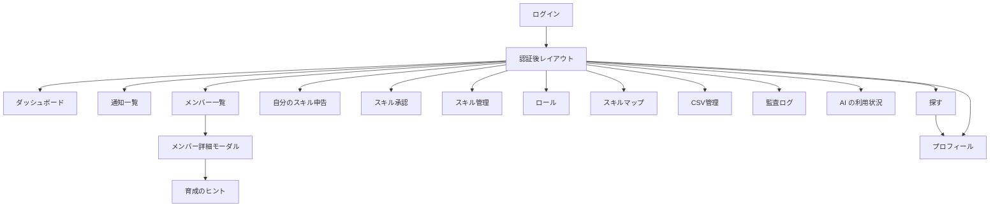
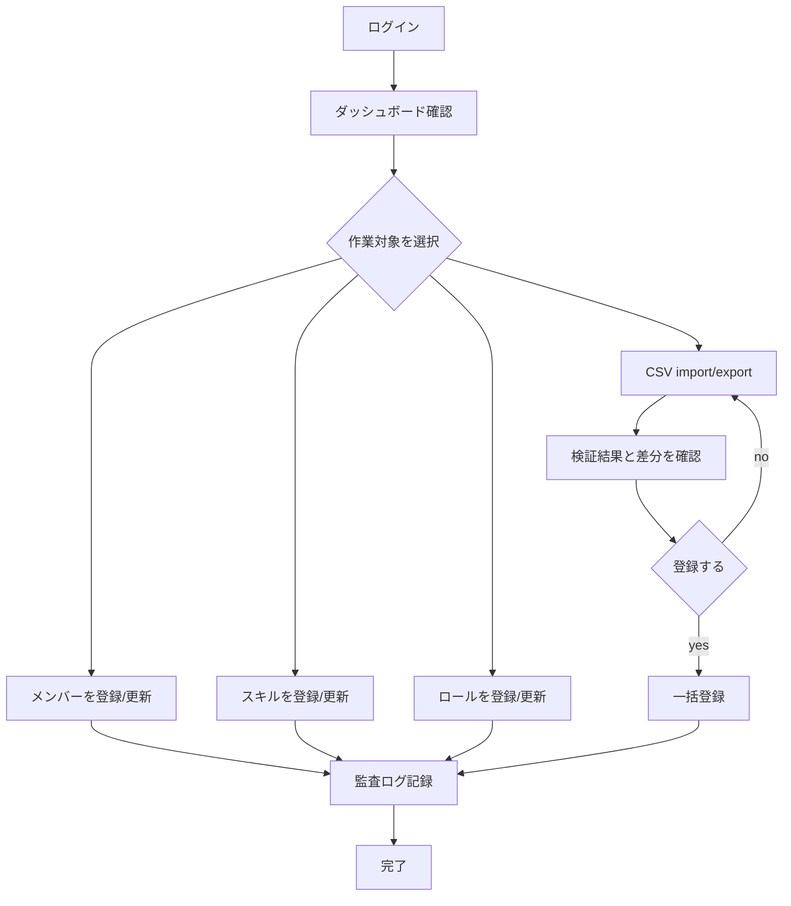
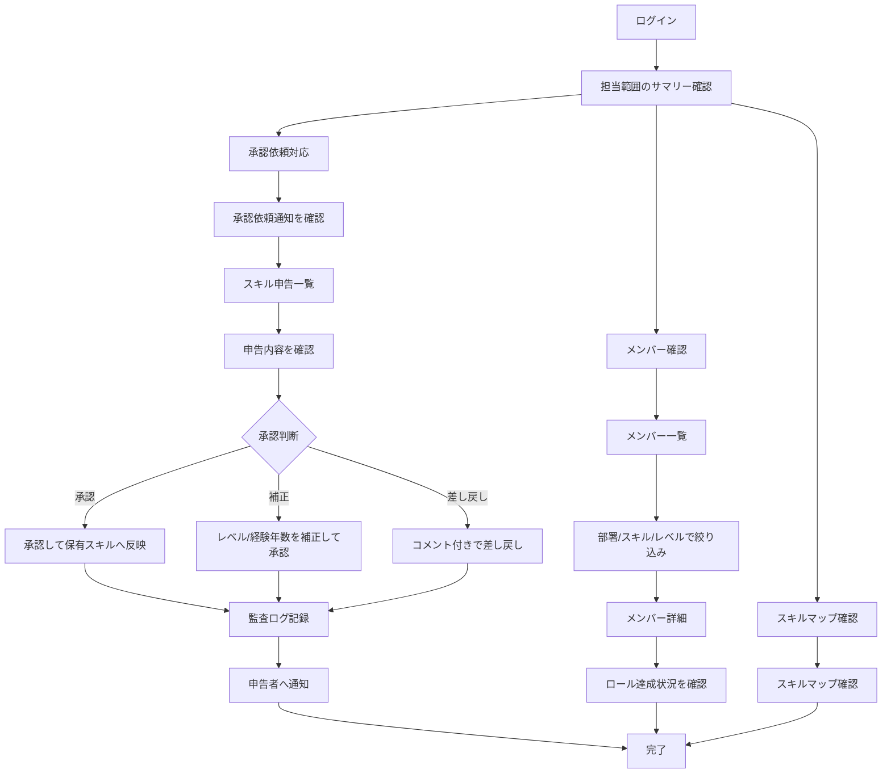
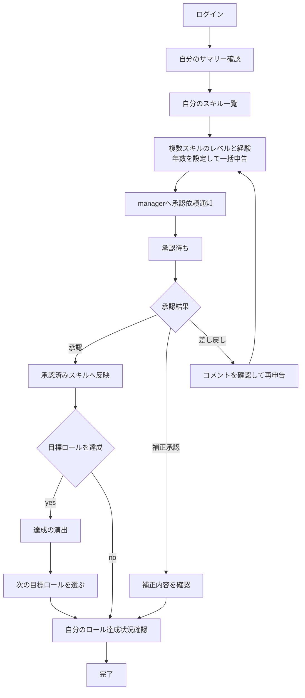
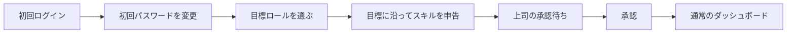
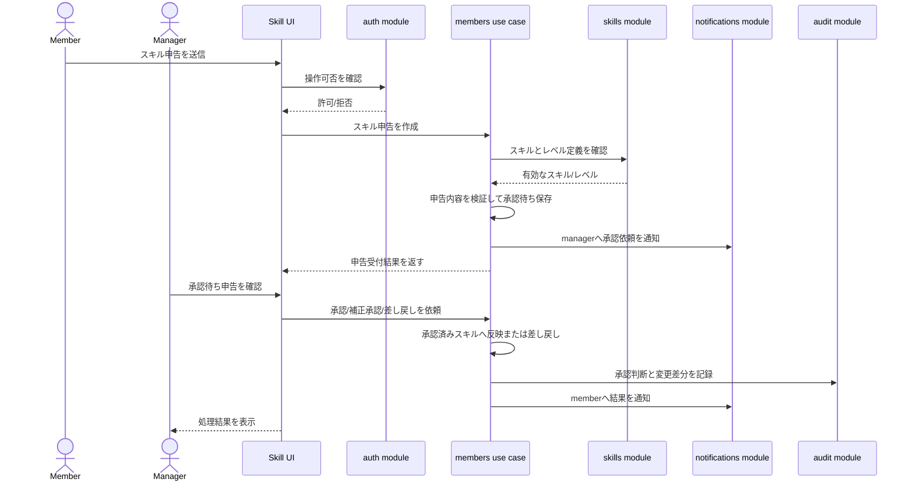

# 画面一覧とユーザーフロー

## 目的

このドキュメントは、画面一覧と主要ユーザーフローを整理します。

フローはGitLab Markdownで閲覧できるように、標準的なMermaid記法で記述します。

## 画面一覧

| 画面 | パス | 主な利用者 | 概要 |
| --- | --- | --- | --- |
| ログイン | `/login` | 全ロール | メールアドレスとパスワードでログイン |
| ダッシュボード | `/dashboard` | 全ロール | `admin`・`manager`は組織集計、`member`は本人のスキルと成長課題 |
| 通知一覧 | `/notifications` | 全ロール | ヘッダーに未読件数を表示し、確認後は対応画面へ遷移 |
| メンバー一覧 | `/members` | `admin`、`manager` | 検索、部署フィルタ、スキル条件検索、行選択による詳細モーダル表示 |
| メンバー詳細 | `/members` のモーダル | `admin`、`manager` | 「育成」と「アカウント」を分け、成長情報と管理項目を表示 |
| 自分のスキル申告 | `/my/skills` | `member`、`manager`、`admin` | カテゴリごとのスキルシートでLvを選び、変更した行をまとめて申請 |
| スキル承認 | `/skill-approvals` | `manager`、`admin` | 申告スキルの承認、補正承認、差し戻し |
| スキル管理 | `/skills` | `admin` | スキルの作成・更新・無効化はダイアログで行う。一覧上でカテゴリとスキルを並び替え、共通・個別のレベルの目安を編集 |
| ロール | `/roles` | 全ロール | ロール一覧、必要スキル、自分の達成状況。`manager`は担当範囲、`admin`は全社の状況と編集機能も表示 |
| スキルマップ | `/skill-map` | `admin`、`manager` | メンバー x スキルのマトリクス |
| CSV管理 | `/csv` | `admin` | import/export、プレビュー、差分確認 |
| 監査ログ | `/audit-logs` | `admin` | 操作履歴の検索、確認 |
| 育成のヒント | `/members` のメンバー詳細タブ | `admin`、担当範囲内の`manager` | 承認済みスキルと目標ロールをもとに作成 |
| AI の利用状況 | `/ai-usage` | `admin` | 実行回数、トークン数、失敗割合、月間上限を確認 |
| レベルアップ | `/level-ups/[levelChangeId]` | `admin`、本人の上司、同じ部署の在籍中の人 | リアクション、コメントの全件、返信の欄。通知と個人ダッシュボードの成長の記録から開く。ナビには置かない |
| プロフィール | `/people/[memberId]` | 全ロール | ひとことと数字、「いま挑戦中」「得意なスキル」「こんなことで相談に乗れます」の3枚のカード、バッジ欄。本人はひとことと相談タグを編集 |
| 振り返り | `/my/recap` | 全ロール（本人のデータ） | 月ごとの「今月のあなた」。月初の演出と個人ダッシュボードのカードから開く。ナビには置かない |
| 探す | `/explore` | 全ロール | いま伸びている技術、おすすめの人、スキルとレベルで人を探す |
| パスワード変更 | `/account/password` | 全ロール | 自分のパスワードを変更する。初回ログイン後は必須 |

## 画面構成

主要画面は、認証後のアプリケーション領域に配置します。

## `admin` ユーザーフロー

`admin` は初期データ整備、マスタ管理、CSV import、監査ログ確認を担当します。

## `manager` ユーザーフロー

`manager` は担当範囲のメンバー確認、スキル申告の承認・補正、検索、可視化を主に利用します。

## `member` ユーザーフロー

`member` は自分のスキル申告を行い、承認状況や承認済みスキルを確認します。マスタ更新、CSV import、監査ログ閲覧は行えません。

### 初めての人の流れ

初回利用時は、空のダッシュボード部品を並べず、「はじめの3ステップ」で次の行動を案内します。承認済みのスキルが1件以上になると、この案内はヘッダーとダッシュボードから消え、通常の成長画面へ切り替わります。

## 主な画面の内容

### 組織ダッシュボード、プロフィール、ロール、スキル管理、初回ログイン

- 組織ダッシュボードは部署の木から対象を選ぶ。`MANAGER`には自部署と配下に加え、並列部署そのものの匿名集計を表示し、成長の勢いなどを先月までの完了月で比較する。
- プロフィールは、上部にひとこと・数字（始めた日数、レベルアップ、達成したロールなど）、その下に「いま挑戦中」「得意なスキル（上位5件）」「こんなことで相談に乗れます」の3枚のカードを置き、本人だけがひとことと相談タグを編集する（飾るバッジはR7で廃止）。
- ロール画面は全ロールが閲覧できる。達成状況を確認し、`ADMIN`は通常要件と「いずれか1つ」の組を編集できる。
- スキル管理は一覧のままドラッグ＆ドロップで並び替えて自動保存する。`ADMIN`は共通のレベルの目安も編集できる。
- 初回ログイン用パスワードは登録・再発行時に一度だけ表示し、初回ログイン後の変更を必須とする。

### スキルシート、承認、レベルアップ

- スキルシートは、上に大分類のタブとカテゴリのチップ、件数付きの絞り込み（新着、目標ロールに必要、しばらく申請なし、未登録、変更あり）を置く。行の印はツールチップで説明し、右側に選んだレベルとその上下の目安を並べる。申請には任意の「ひとこと」を付けられる。
- 承認画面は、申請ごとに確認ポイントのバッジを出し、行を開くと詳しい文、レベルの分布、ひとこと、これまでの申請を見られる。確認ポイントの有無で絞り込み、「確認ポイントなしをすべて選ぶ」でまとめて承認できる。
- スキル管理には「大分類」と「スキルの関係」のタブがある。スキルの関係は、AIの候補をチェックしてまとめて登録するか、手で追加する。
- 個人ダッシュボードに「新しいスキル」「見直してみませんか」のカードを出す。成長の記録の各行からレベルアップの画面を開ける。
- チーム表示のKPI上部に、マネージャー本人が決めるチーム目標と進み具合を表示する。個人表示では、上司の今の目標があるメンバーだけに同じ進み具合を表示する。
- リアクションとコメントの通知から、レベルアップの画面に移動する。本人はだれがリアクションしたかを見て、返信できる。

### 振り返りとバッジ

- 月が変わって最初に開いたとき、先月に出来事があれば「先月の振り返り」の演出を1回出す。閉じるとその月は出さない。
- 振り返りの画面（`/my/recap`）は、ひとこと、数字4つ（前の月との差）、12か月の推移、レベルアップしたスキル、目標ロールの月初→月末、新しいバッジ、届いた声、来月の一歩を並べ、月を切り替えられる。
- 個人ダッシュボードの上部に「N月のあなた」のカードを置く。バッジ欄は「最近とったバッジ」3つと「次に取れそう」2つに絞り、「すべて見る」で自分のプロフィールのバッジ欄へ移動する。
- メンバー詳細には「振り返り」タブがある。上司は出来事の行から、下書き入りで1on1メモに追加できる。
- プロフィールには「バッジ」欄がある。成長・つながり・シークレットに分け、押すと条件と獲得日を出す。本人には進み具合も出す。
- 一番乗りのレベルアップには、フィード、成長の記録、レベルアップの画面、振り返りで「一番乗り」の印を付ける。

## スキル申告・承認シーケンス

メンバースキルは、原則としてメンバー自身の申告を起点にし、managerが承認または補正承認した時点で承認済みスキルへ反映します。

## 作っていない画面

| 画面 | 理由 |
| --- | --- |
| CSV承認画面 | CSVの取り込みは`admin`だけが行い、プレビューと差分確認で確かめるため |
| 外部連携設定 | 外部人事システム連携を扱っていないため |
